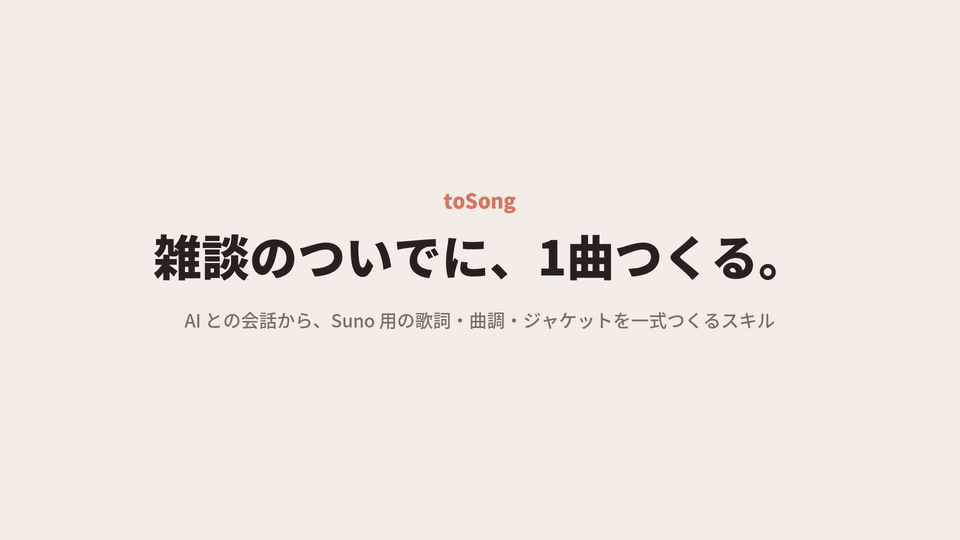

# toSong


> [!NOTE]
> このプロジェクトは現在**開発中（実験段階）**です。スキル構成・手順・出力形式は予告なく変更されることがあります。
>
> **現在の状況・課題**
> - 楽器タグの多用・`Only` 系タグ無視による平坦化／息苦しさは、Suno `v6-mini` 実機検証を経て**「短い自然言語 Style ＋ 単独行の最小引き算タグ」**へ刷新し解消しました（2026-11-20）
> - サビのフック・反復の気持ちよさでは Suno 自動生成に負ける場面があり、サビ設計を継続改善中です

**toSong は、音楽生成 AI「Suno AI」に入力するための『歌詞・Style プロンプト・パラメータ一式』を、思いつきや手元の資料から自動で組み立てる AI エージェント向けスキル群（Suno 専用プロンプター／制作ワークフロー）です。**

※ このリポジトリ自体は音声ファイル（MP3/WAV）を直接生成しません。Suno の **Custom Mode** にそのままコピペして「Create」を押すだけの状態を作るための設計・プロンプト生成ツールです。

## デモ：雑談のお題が 1 曲になるまで

<a href="docs/demo.mp4"></a>

| Before | Process | After |
| :--- | :--- | :--- |
| AI との雑談で出たお題 | `/toSong` に貼っておまかせで歌詞・Style・ジャケットを生成し、`suno-paste.md` を Suno（無料プラン）に貼って Create | 『三コマ目のドアノブ』 [](https://suno.com/s/ACwcZl4hpqH89E9g) |

※ GIF は無音です（リンク先の MP4 は BGM 付き、曲本編は Suno のリンクから聴けます）。

---

## Suno デフォルト（自動作詞）との比較・作成時間

### 作成時間（実測）

工程見直し後の現行パイプライン（歌詞・Style・貼り付けファイル一式の生成まで、`timing.log` 実測値）です。別途 Suno 側での楽曲生成に数十秒かかります。

| ルート | 内容 | 実測時間 |
|---|---|---:|
| 種ルート（通常） | 元ネタ（雑談ログ・資料）から 6 ロール一貫生成 | **1分57秒** |
| 苗木ルート（短縮） | 制作指示書・テーマ設計から前処理を省いて生成 | **1分25秒** |

※ 旧設計（テスト時 約 10 分）からパイプライン整理により約 1.5〜2 分まで短縮しています。

### 比較条件（公平性ルール）

- **同一条件**：同じお題（日常の AI チャットログ 2 種）と **完全に同じ `Style of Music`** を使用
- **比較相手**：Suno Custom Mode の自動作詞機能（Write with Suno）で各題 2 パターン生成し、**全結果を掲載**（良い結果だけの切り抜きなし）
- **採点方法**：楽器タグや分かち書き等の書式差を除去し、提示順をシャッフルした状態で **3 視点の LLM 審査員（作詞家・リスナー・ボーカリスト）による完全ブラインド採点**（5 項目 × 5 点 ＝ 25 点満点、3 名合計 75 点満点）を実施
- **権利上の配慮**：Suno 自動生成の歌詞テキストはリポジトリに保存せず、Suno 公式の共有リンクと評価結果のみを掲載しています

### 聴き比べ（Suno 共有リンク）

| お題・曲調 | toSong | Suno 自動生成 A | Suno 自動生成 B |
|---|---|---|---|
| **1. 深夜のレポート相談**<br>82 BPM / Lo-fi Indie Folk | [](https://suno.com/s/aWr0qYq4Sm8MViIq) | [](https://suno.com/s/l4MCwK5HyjF3k8dI) | [](https://suno.com/s/7gvpglinAv6NoRLg) |
| **2. 友達への断り文相談**<br>122 BPM / Acoustic Pop Rock | [](https://suno.com/s/IsBhGv2QyNwXnijW) | [](https://suno.com/s/FQggxL0V6yyhOmjW) | [](https://suno.com/s/sNFBeWGK3NHV8TUR) |

### ブラインド採点結果（3 審査員合計 / 75 点満点）

| 曲 | toSong | Suno 自動生成 A | Suno 自動生成 B |
|---|---:|---:|---:|
| 1. 深夜のレポート相談（『朝九時のバトン』） | **61**（全審査員 1 位） | 52 | 54 |
| 2. 友達への断り文相談（『短いほんねの帰り道』） | **67**（全審査員 1 位） | 47 | 47 |
| **2 曲合計（150 点満点）** | **128**（平均 21.3 / 25） | 99 | 101 |

<details>
<summary>評価基準と項目別の傾向（2 曲合算 / 各 30 点満点）</summary>

評価基準（各 5 点満点 × 3 審査員 × 2 曲 ＝ 30 点満点）：
1. 題材への忠実さ・独自性 / 2. 歌いやすさ・リズム感 / 3. 情景の具体性・人間味 / 4. 構成・緩急・ストーリー展開 / 5. 作品としての魅力

| 項目（30 点満点） | toSong | Suno 上位側（参考） | 傾向 |
|---|---:|---:|---|
| 1. 題材への忠実さ・独自性 | **25** | 25（1a:14 + 2a:11） | 拮抗（固有名詞の忠実さは Suno が勝つ場面あり） |
| 2. 歌いやすさ・リズム感 | 20 | **25**（1b:13 + 2b:12） | **Suno 自動生成が優勢** |
| 3. 情景の具体性・人間味 | **30** | 23（1b:12 + 2a:11） | **toSong が全 6 審査員で満点** |
| 4. 構成・緩急・ストーリー展開 | **28** | 16（1a:10 + 2a/2b:6） | **toSong が大差で優勢** |
| 5. 作品としての魅力 | **25** | 21（1b:11 + 2b:10） | toSong が優勢 |

</details>

### 強みと正直な弱み（ブラインド審査＋実聴メモ）

- **toSong の強み**
  - **人間味・生活の手触り**：身体感覚や日常音で感情を立ち上げ、全 6 審査員から満点評価。実聴でも「一番人間らしい」質感が出た。
  - **物語の起伏（抑圧 → 解放）**：1・2 番で葛藤を溜め、Bridge〜Final Chorus で解放する構成が安定して機能する。
- **toSong の弱み（比較実験時点）**
  - **2 行ごとの楽器タグ過多による息苦しさ**：実聴では、曲調によって気持ちよさが乗る前に切り替えが入り息苦しく聴こえる場面があった（`Only` 系タグも無視されがち）。→ ※その後、2 行ごとのタグ追加と `Only` 系タグを廃止し、Suno `v6-mini` 検証済みの「短い自然言語 Style ＋ 最小引き算タグ（`[Solo 〜]` / `[Stripped Back]` / `[Breakdown]` / `[Silence]` / `[End]`）」へ改善済み。
  - **フックの抜け・歌いやすさ**：音数や反復の気持ちよさでは Suno 自動生成に負ける項目があり、元ネタの象徴語（白湯・黄色い付箋・コロッケ等）を普遍化しすぎて薄れることがある。
- **Suno 自動生成の強み・弱み**
  - **強み**：メロディへの乗り・フックの気持ちよさ・聴きやすさが高く、実聴でも「今っぽくて気持ちいい」曲が出やすい（特に 2 曲目 A はベースに乗る流れが良好）。
  - **弱み**：1 番サビでオチまで完結してしまい、2 番で時系列が巻き戻ったり同じサビの反復で平坦になりやすい。書き言葉・優等生的なまとめ方になり、生の葛藤が薄れやすい。

---

## 必要なもの

- **スキル対応の AI コーディングエージェント**：`SKILL.md` 形式を読み込めるツール（Claude Code、Antigravity、OpenCode など）
- **Python 3**：音韻・表記チェッカー（`check_lyrics_audio.py`）、貼り付け用ファイル生成（`generate_paste.py`）、所要時間集計（`calc_timing.py`）の実行に使用（標準ライブラリのみで動作）
- **Suno AI アカウント**：出力された歌詞・Style を Custom Mode に貼り付けて楽曲を生成するため（Free / Pro / Premier いずれも対応）
- **VOICEVOX Engine**（任意）：ローカル起動（`http://127.0.0.1:50021`）していると `check_lyrics_audio.py` で実読み上げ音声（`preview.wav`）と精密モーラ検証まで実行可能。未導入でも `--offline` モードで音韻・多音字・反復チェックが動作します
- **画像生成手段**（任意）：最終ステップでジャケット画像（`cover.jpg`）を生成する場合に使用（`cf-image` 等の画像生成 MCP ツールなど。画像なしで進める場合は不要）

## インストール方法

1. リポジトリを取得します。
   ```bash
   git clone https://github.com/likeUdonThanRamen/toSong.git
   ```
2. `skills/` 配下の 3 フォルダ（`toSong`, `genStyle`, `song-review`）を、お使いの AI エージェントのスキルディレクトリへコピー（または配置）します。
   - **Claude Code**：`~/.claude/skills/`（またはプロジェクトの `.claude/skills/`）
   - **Antigravity**：`~/.gemini/config/skills/`（またはワークスペースのスキルディレクトリ）
3. AI エージェント上で「`/toSong`」や「この資料から曲を作って」「お任せで曲を作って」と指示して開始します。

---

## 出力ファイルと Suno への貼り付け方

制作が完了すると、曲フォルダ（`songs/<曲名>/`）の直下には **Suno 貼り付け用ファイル（`suno-paste.md` / `suno-paste.html`）** と **ジャケット画像（`cover.jpg`）** のみが出力されます。単体テキストや制作過程の資料はすべて `work/` サブフォルダに格納されます。

Suno に貼り付けるときは、ブラウザで `suno-paste.html` を開いて各「コピー」ボタンを押すか、`suno-paste.md` 内の各コードブロックを上から順（Lyrics → Style of Music → Title）にコピーしてください。

### 1. 曲フォルダ直下（ルート）
| ファイル | 内容 |
|---|---|
| `suno-paste.html` | ブラウザで開いてワンクリックでコピーできる貼り付け用ページ（Suno Custom Mode 順：Lyrics → Style of Music → Title） |
| `suno-paste.md` | Suno の Custom Mode にそのまま貼れるコードブロック集（上から Lyrics → Style of Music → Title、有料プラン時は Exclude Styles / パラメータも収録） |
| `cover.jpg` | 曲タイトルと空気感に合わせたジャケット画像（画像生成を有効にしている場合） |

### 2. `work/` サブフォルダ（単体テキスト・制作過程の資料）
- 単体ファイル：`title.txt`, `style.txt`, `lyrics.txt`（有料プラン時は `exclude.txt`, `settings.txt` も生成）
- 制作資料：`00_diagnosis.md`（入力診断）, `01_delivery.md` 〜 `06_styles.md`（各ロール出力）, `audio-check.md`（音韻チェック結果）, `timing.log`（所要時間ログ）, `review.md` 等

---

## 収録作品（`works/`）

| 三コマ目のドアノブ | とりあえず起きてから |
| :---: | :---: |
| <a href="https://suno.com/s/ACwcZl4hpqH89E9g"></a> | <a href="https://suno.com/s/K1M5T7TxHk4mC457"></a> |
| [](https://suno.com/s/ACwcZl4hpqH89E9g) | [](https://suno.com/s/K1M5T7TxHk4mC457) |
| [作品データ](works/三コマ目のドアノブ/) | [作品データ](works/とりあえず起きてから/) |

> GitHub の Markdown 仕様上、外部オーディオプレイヤー（`<iframe>` 等）の直接埋め込みは非対応のため、ジャケット画像・再生バッジから Suno 公式ページへリンクしています。

---

## 収録スキル（`skills/`）

| スキル / 資料 | 役割 |
|---|---|
| [`skills/toSong/`](skills/toSong/SKILL.md) | ステップ 0（入力診断 ＆ 3 スイッチ）＋最大 6 ロール＋音韻チェッカーで楽曲一式を組み立てるメインパイプライン |
| [`skills/toSong/references/Suno作曲メソッド.md`](skills/toSong/references/Suno作曲メソッド.md) | 構成・作詞・最小引き算メタタグ・自然言語 Style／パラメータ設定の共通ルール集 |
| [`skills/toSong/references/story-guide.md`](skills/toSong/references/story-guide.md) | 物語構成・コンセプト設計の補助ガイド |
| [`skills/toSong/references/lyrics-guide.md`](skills/toSong/references/lyrics-guide.md) | ワードマイニング・感情フィルター・モーラ／譜割りの補助ガイド |
| [`skills/genStyle/`](skills/genStyle/SKILL.md) | コンセプト・曲調から Suno AI の `Style of Music` / `Exclude Styles` を設計 |
| [`skills/song-review/`](skills/song-review/SKILL.md) | 作曲家・作詞家・AI 作曲家（Suno 専門家）の 3 視点で歌詞と Style をレビューし、普遍的知見をメソッドへ還元 |

## 制作パイプライン（`toSong` v3）

入力の熟度に合わせて不要な前処理を省き、役割分離と自動音韻チェックを通して Suno 向けに仕上げます。

0. **ステップ 0：入力診断 ＆ 3 スイッチ（`00_diagnosis.md`）**：入力が「種（出来事メモ・お任せ）」か「苗木（制作指示書・テーマ設計）」かと表現の型（構造型・視点距離・時間構造）を判定し、必要な前処理だけをオン／オフ
1. **① 配達員（`01_delivery.md`）** *(種ルート)*：元のメモから事実・出来事・時間経過だけを抽出（解釈禁止）
2. **② 選別者（`02_selection.md`）** *(種ルート)*：核となるモチーフを 1〜2 個に絞り、名詞の渋滞を防ぐ
3. **③ 構成作家（`03_story.md`）** *(種ルート)*：主人公の人物像（口ぐせ含む）と、因果が通る 4 コマプロット（Before → After）を設計
4. **④ 生活実感・象徴メモ（`04_life_details.md`）**：`種` は誰でも覚えのある身体感覚・仕草、`苗木` は守る制約・象徴と温度変化を整理
5. **⑤ 作詞家 ⇄ 音韻チェッカー（`05_lyrics.txt` / `audio-check.md`）**：ラスサビ先作り・最小引き算メタタグ（`[Solo 〜]` / `[Stripped Back]` / `[Breakdown]` / `[Silence]` / `[End]`）で歌詞化し、`check_lyrics_audio.py` でモーラ・多音字・反復・禁止記号を自動検証
6. **⑥ 編曲家（`06_styles.md`）**：ジャンル・BPM・声質と静／動の楽器役割分担を短い自然言語（2 文程度）で `Style of Music` に調律
7. **⑦ タイトル・ジャケット・整理**：タイトル確定・ジャケット画像（`cover.jpg`）生成・貼り付け用ファイル（`suno-paste.html` / `suno-paste.md`）を出力（仕上げに `/song-review` でブラッシュアップ）

## ディレクトリ構成

- `skills/` : 公開用スキル（`toSong`, `genStyle`, `song-review`）とスクリプト・メソッド文書
- `works/` : 制作した楽曲データ（Suno 貼り付け用テキスト・制作過程データ・Suno 公式共有リンクなど）

## 公開方針（Suno 音源の扱い）

- Suno Free プランで生成した楽曲は非商用利用限定のため、MP3 / WAV などの音声ファイル自体はリポジトリに同梱しません。
- 各作品フォルダ（`works/` 配下）では、歌詞・Style・制作過程データとあわせて **Suno の公式共有リンク（URL）** を掲載します。

## ライセンス

[MIT License](LICENSE)
