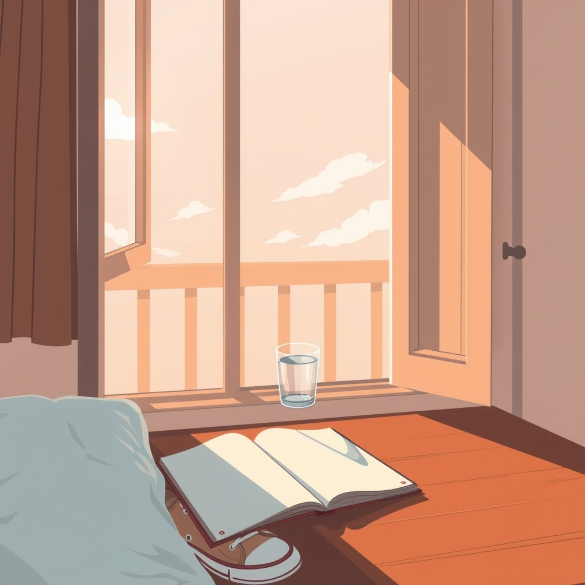

# とりあえず起きてから

Suno AI（Custom Mode）貼り付け用です。ブラウザで [suno-paste.html](suno-paste.html) を開くとワンクリックでコピーできます。

## Lyrics

```text
[Intro]
[Acoustic Guitar]

[Verse 1]
[Acoustic Guitar, Upright Piano]
集中が 切れた夜
あと一戦だけ クリックした
机の端に 積んだままの
分厚い本を 見て見ぬふり

外へ出ようと 靴を履いて
ひんやりした 夜道を歩く

[Pre-Chorus]
[Half-time, Sparse Piano]
オレンジ色の ひさしの下
甘いパイと 苦いコーヒー
冷えた指先 かばうよう
熱いカップを 握りしめた

素直に家へ 帰る気には
なれなくて 遠回りする

[Break]

[Chorus]
[Full Band]
行けないわけ じゃないんだよ
ただ 行きたくないだけで
冷えた夜風に 背中押され
鍵を回して 部屋に戻る

机の端の 本はまだ
きのうのまま そこにある
とりあえず 起きてから
考えよう

[Instrumental Turnaround]

[Verse 2]
[Steady Groove, Warm Bass]
わずか三時間 眠った朝
アラームを止めても 動けない
起きてはいたけど 起きれなくて
天井ばかり 見つめている

一時間半の 電車の揺れ
思い浮かべて 重くなる肩

[Bridge]
[Sparse Piano, Acoustic Guitar]
ちゃんとしなきゃの 声がどこか
机の端から 聞こえるけど
靴も履かずに シーツの隅で
深呼吸を ひとつだけ

[Chorus]
[Full Band]
行けないわけ じゃないんだよ
ただ 行きたくないだけで
大きな窓の 光のすじが
シーツのしわを 照らしてく

机の端の 本はまだ
開く気配も ないけれど
とりあえず 起きてから
考えよう

[Outro]
[Acoustic Guitar, Soft Piano]
とりあえず 起きてから
[Ring Out]
[End]
```

## Style of Music

```text
Indie Acoustic J-Pop, Warm Conversational Male Vocal, Fingerpicked Acoustic Guitar, Upright Piano, Warm Electric Bass, Soft Brushed Drums, 96 BPM, Intimate Bedroom Folk
```

## Title

```text
とりあえず起きてから
```

---

## 有料プラン（Pro / Premier）追加設定

### Exclude Styles

```text
synth, auto-tune, screaming
```

### Parameters

```text
Custom Mode: ON
Instrumental: OFF
Style Influence: 65%
Weirdness: 30%
```

## Cover Image


