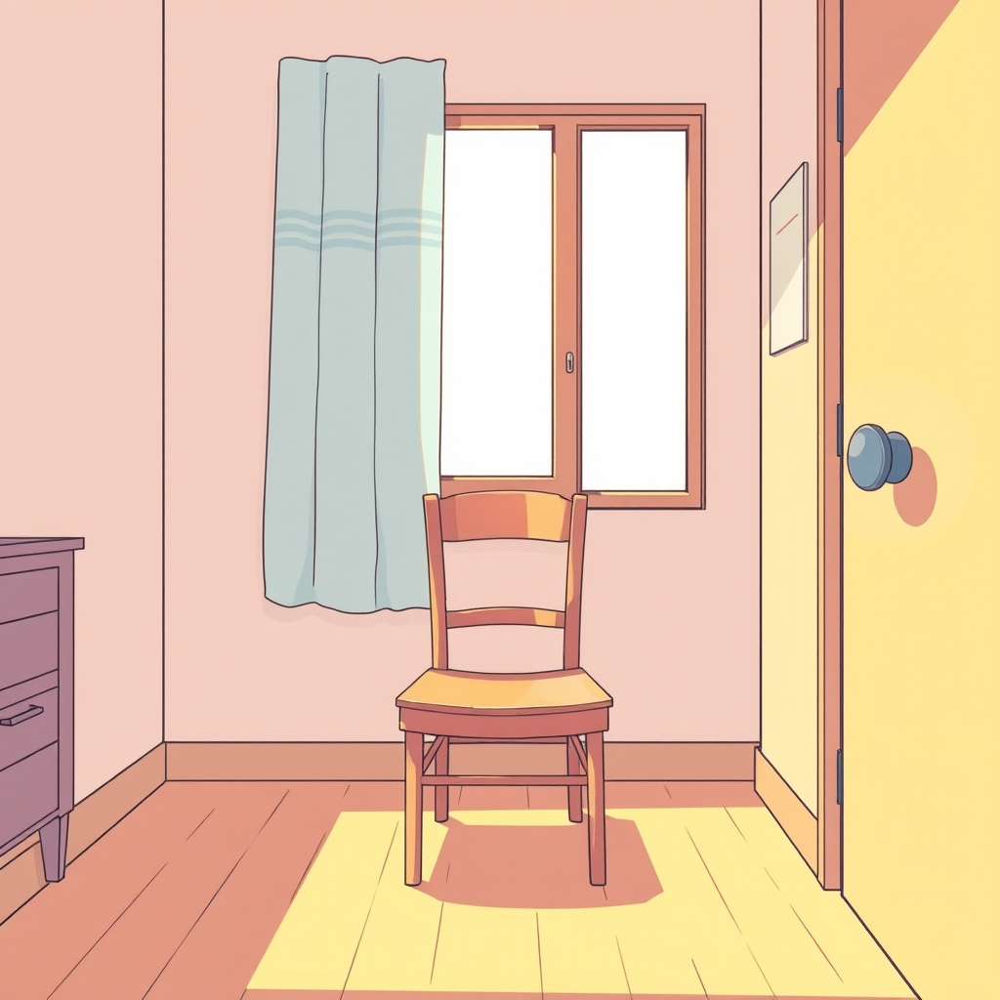

# 三コマ目のドアノブ

Suno AI（Custom Mode）貼り付け用です。ブラウザで [suno-paste.html](suno-paste.html) を開くとワンクリックでコピーできます。

## Lyrics

```text
[Intro]
[Staccato Piano]

[Verse 1]
夕方 まえの 静かな 部屋
真ん中の 椅子に 腰を おろす
もうすぐ だれかが やって くる
きょうこそ うまく むかえるんだ

[Pre-Chorus]
[Half-time]
[Sparse Piano]
足音が もう すぐ そこに
心臓が うるさく はねる
背筋 のばして いま 息を 吸う
ドアノブを じっと にらむ

[Break]

[Chorus]
[Full Band]
ドアノブが カチャリと まわる 音
見知らぬ 柔軟剤の におい
ぼくは 椅子の うえで かたまる
ここは ぼくの 部屋じゃ ないんだ
いち にコマの まじめな ぼくが
さんコマめで オチに かわるよ

[Verse 2]
さっきまでの しんけんな 顔
笑顔まで れんしゅう してたのに
気合 いれて 両足 そろえ
時間 どおりに 待ちかまえてた

[Pre-Chorus]
[Half-time]
[Sparse Piano]
だれも こないはずの 部屋で
ひとりだけ 準備 ばんたん
顔を あわせて ふたり とも
うごけなく なって しまう

[Break]

[Bridge]
[Bass Solo]
ふくろ さげた ひとが いった
えっと どちらさま ですか
あわてて 椅子から 立ちあがる
すみません 部屋を まちがえました
ぼくの 部屋は さんかい なのに

[Chorus]
[Full Band]
ドアノブが カチャリと まわる 音
見知らぬ 柔軟剤の におい
ぼくは 椅子の うえで かたまる
ここは にかい だったんだね
いち にコマの まじめな ぼくが
さんコマめで オチに かわるよ
まあ いっかと わらうしか ないね

[Outro]
[Staccato Piano]
いすを おりて さんかいへ いこう
```

## Style of Music

```text
Playful Jazzy J-Pop, Expressive Bright Male Vocal, 132 BPM, Bright Major Key, Staccato Piano, Upright Bass, Tight Crisp Drums, Playful Brass, Dynamic Contrast, Crisp Modern Production
```

## Title

```text
三コマ目のドアノブ
```

## Cover Image


