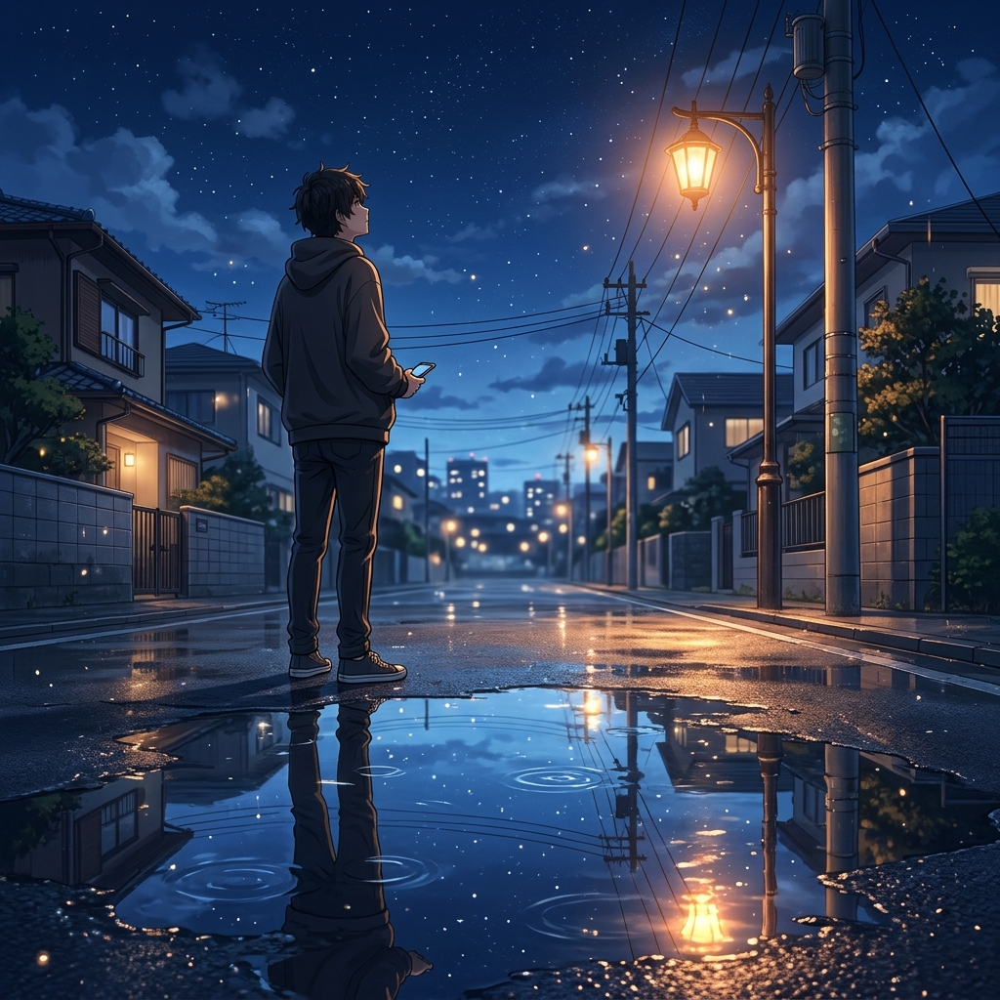

# 水たまりが光を返すまで（toSong デモ）

[](https://suno.com/s/z7HarBUlpCsb0QOg)

[](https://suno.com/s/z7HarBUlpCsb0QOg)

- **Suno 共有リンク**: https://suno.com/s/z7HarBUlpCsb0QOg
- **Style**: `Japanese Indie Pop, Warm Piano Pop, Intimate Breathy Male Vocal, Whispery Verse to Expressive Chorus, 124 BPM, 4/4 time, E major, Warm Felt Piano, Clean Electric Guitar, Analog Synth Pad, Tight Soft Drums, Dynamic Contrast, Crisp Modern Production, Dramatic Key Change in Final Chorus, Explosive Final Chorus`

> **「どうにもならなかったこと」を AI に吐き出して、数分で心を軽くする 1 曲へ。**
> ただの要約ではなく、**画像生成 → 情景リーディング → 短編小説 → 音響・歌詞設計** のパイプラインを通すことで、そのまま Suno AI に貼れるプロ品質の楽曲一式を生成します。

---

## 1. このリポジトリでできること（3ステップ）

```text
[1] AIと壁打ち・愚痴る（いつものチャット）
        │
        ▼ 「この話を歌にする用にまとめて」
[2] まとめテキスト（input-chat-summary.md）
        │
        ▼ 「/toSong このまとめから曲を作って」
[3] 完成データ一式（Suno へそのままコピペ）
    ├── title.txt    （曲タイトル）
    ├── lyrics.txt   （モーラ・ブレス・日本語発音まで設計済み）
    ├── style.txt    （先頭20〜30語に重みを凝縮した Style）
    ├── exclude.txt  （ジャンル崩れを防ぐ除外タグ）
    └── settings.txt （Influence / Weirdness 推奨値）
```

---

## 2. デモ用プロンプト集（そのまま試せます）

### パターンA：今のチャットの流れからそのまま歌にする（一番おすすめ）
AI に悩みや出来事を相談したあとのセッションで、そのまま次のように打ちます。

```text
ここまで話した内容を整理して、/toSong で1曲作って。
タイトルは最後に決めて、一気通貫で Suno に貼れるファイル一式まで出して。
```

### パターンB：まずテキストにまとめてから渡す（2段階）
1. **チャットをまとめるプロンプト**
   ```text
   今のモヤモヤと、話して見えてきた気づきを、歌の素材用として短く箇条書きにまとめて。
   ```
2. **まとめたテキストを歌にするプロンプト**
   ```text
   /toSong docs/tosong-demo/input-chat-summary.md をもとに1曲作って。
   ```

### パターンC：既存曲のブラッシュアップ（仕上げ）
```text
/song-review 作った歌詞と style.txt を、作曲家・作詞家・Suno専門家の3視点でレビューして改善版を作って。
```

---

## 3. デモ実例：『水たまりが光を返すまで』

今回のデモでは、実際に [input-chat-summary.md](input-chat-summary.md) を入力として、**キャラクター化されたペルソナ・MV的カメラ補完・五感・感情フィルター・自由詩** を組み込んだ `/toSong` パイプライン（全8ステップ）を実行しました。

### Before（入力：AIとのチャットまとめの一部）
- 昼間、SNS で同世代のうまくいっている報告ばかりが目に入った。
- 机に向かったけれど数行で手が止まり、暗い部屋でスマホをスクロールして自己嫌悪。
- 「他人のペースと自分の歩幅をごちゃ混ぜにして息切れしているだけ」と気づいた。

### なぜいきなり歌詞を書かないのか？（クオリティの秘密）
1. **画像（空間・偶然）とテキスト（時間・カメラ・五感）をつなぐ**（[visual_noon.jpg](work/visual_noon.jpg) / [visual_1.jpg](work/visual_1.jpg) / [visual_2.jpg](work/visual_2.jpg) / [ペルソナ.md](work/ペルソナ.md)）
   - 絵から拾ったディテールに、**主観POV（見上げた高架橋・水たまりの反射）・インサート（前髪を揺らす夜風）・触覚/嗅覚/味覚・周囲の音の流れ**、さらに **外に見せる強がり vs 内側の弱い自分** というキャラクター設定を合流させます。
2. **短編小説と制約なしの自由詩を書く**（[story.md](work/story.md) / [poetry.md](work/poetry.md)）
   - 物語を書き切ったあと、行数やモーラ数の制限を外して**自由詩**をたっぷり書き、同じ「水たまり」が不安時（歪む鏡）から回復時（足を照らす光）へ反転する比喩を育てます。
3. **Suno AI の仕様に合わせた音・歌詞設計**（[lyrics.txt](lyrics.txt) / [style.txt](style.txt)）
   - 自由詩から強いフレーズを選び取り、1番（昼の雑踏）→ Bメロ引き算（`[Vocals Only]` `[Break]`）→ 2番（`[Piano only]` の深夜）→ ラスサビ解放へ落とし込みます。

### After（出力サンプル・一部抜粋）
- **タイトル**: 『水たまりが光を返すまで』
- **貼り付け用データ**: [title.txt](title.txt) / [lyrics.txt](lyrics.txt) / [style.txt](style.txt) / [exclude.txt](exclude.txt) / [settings.txt](settings.txt)
- **設計のハイライト**:
  - **タイトルと比喩の一貫性**: 1番で「水たまりに揺れるビルとぼやけた僕」だったものが、画面を伏せたあとのラスサビでは「水たまりさえ星を映して ぼくらの道そっと照らした」と反転し、タイトルの伏線を全編で回収します。

---

## 4. フォルダ構成

```text
docs/tosong-demo/
├── README.md                  # 本ガイド・デモ用プロンプト集
├── input-chat-summary.md      # 入力例：AIとのチャットまとめテキスト
├── title.txt                  # 出力（Suno貼り付け用）：曲タイトル
├── lyrics.txt                 # 出力（Suno貼り付け用）：歌詞
├── style.txt                  # 出力（Suno貼り付け用）：Style of Music
├── exclude.txt                # 出力（Suno貼り付け用）：Exclude Styles
├── settings.txt               # 出力（Suno貼り付け用）：パラメータ推奨値
└── work/                      # 制作過程データ
    ├── visual_noon.jpg        # キービジュアル（昼：晩秋のビル街・雑踏）
    ├── visual_1.jpg           # キービジュアル（深夜：青白い画面の光）
    ├── visual_2.jpg           # キービジュアル（深夜：画面を伏せた直後）
    ├── ペルソナ.md            # 時間・環境音リーディングから立ち上げた人物像
    ├── story.md               # 短編小説
    ├── poetry.md              # ワード・マイニング＆詩的圧縮
    └── styles.txt             # Style 設計根拠付きメモ
```
